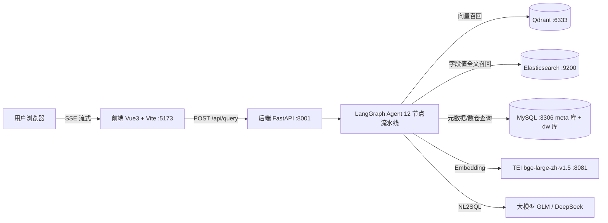

# 掌柜问数(data-agent)

> 基于 **LLM + LangGraph + 检索增强(RAG)** 的对话式数据问答系统(ChatBI / NL2SQL)。
> 用户用自然语言提问,系统自动完成 **关键词提取 → 三路召回 → 语义筛选 → SQL 生成 → 校验 → 执行** 全流程,流式返回查询结果。

## 效果示例

**提问**:`统计一下2025年1月份各品类的销售额占比`

系统自动生成并执行 SQL:

```sql
SELECT dp.category AS 品类, SUM(fo.order_amount) AS 销售额,
       ROUND(SUM(fo.order_amount) * 100.0 / SUM(SUM(fo.order_amount)) OVER (), 2) AS 销售额占比
FROM fact_order fo
JOIN dim_date dd ON fo.date_id = dd.date_id
JOIN dim_product dp ON fo.product_id = dp.product_id
WHERE dd.year = 2025 AND dd.month = 1
GROUP BY dp.category
ORDER BY 销售额占比 DESC;
```

**返回**:

| 品类 | 销售额 | 销售额占比 |
|------|-------:|-------:|
| 手机数码 | 78789.0 | 72.26 |
| 家用电器 | 22396.0 | 20.54 |
| 鞋靴 | 4396.0 | 4.03 |
| 服饰 | 2295.0 | 2.10 |
| 食品饮料 | 885.0 | 0.81 |
| 休闲零食 | 269.5 | 0.25 |

## 系统架构



## 技术栈

| 层 | 技术 | 说明 |
|----|------|------|
| 前端 | Vue 3 + Vite | 单页问答界面,SSE 流式渲染过程与结果表格 |
| 后端 | Python 3.11 + FastAPI + LangGraph | 12 节点状态图驱动,依赖管理用 uv |
| 大模型 | GLM(智谱)/ DeepSeek(OpenAI 兼容协议) | 关键词扩展、语义筛选、NL2SQL |
| 向量模型 | BAAI/bge-large-zh-v1.5(HuggingFace TEI CPU 版) | 1024 维中文向量 |
| 存储 | MySQL 8(meta 元数据 + dw 数仓)、Qdrant(向量)、Elasticsearch(全文) | Docker Compose 一键部署 |
| 可视化 | Kibana :5601 | ES 数据查看(可选) |

## 目录结构

```
3.代码/
├── README.md                    # 本文件
├── docs/                        # 项目文档
│   ├── 产品文档.md               # 定位、功能、场景、规划
│   ├── 开发文档.md               # 架构、配置、接口、调试、故障排查
│   └── 学习指南.md               # 环境搭建、学习路径、练习、FAQ
├── data-agent/                  # 后端(Python)
│   ├── app/
│   │   ├── agent/               # LangGraph 图、状态、上下文、12 个节点
│   │   ├── api/                 # 路由(/api/query,SSE)
│   │   ├── clients/             # MySQL/Qdrant/ES/Embedding/LLM 客户端
│   │   ├── config/              # 配置加载(账密走 .env 环境变量)
│   │   ├── models/              # ORM 与检索文档模型
│   │   ├── prompt/              # 提示词加载器
│   │   ├── repositories/        # 数据访问层
│   │   ├── schemas/             # 请求/响应模型
│   │   ├── scripts/             # build_meta_knowledge 知识库构建脚本
│   │   ├── service/             # 业务服务(问答、元数据知识库构建)
│   │   └── core/                # lifespan、日志、中间件
│   ├── conf/                    # app_config.yaml / meta_config.yaml(无明文账密)
│   ├── prompts/                 # 8 个提示词模板
│   ├── docker/                  # docker-compose.yaml + .env + ES/IK + embedding 模型
│   ├── main.py                  # FastAPI 入口
│   ├── .env.example             # 环境变量模板(复制为 .env 填真实值)
│   └── pyproject.toml
└── date-agent-frontend/         # 前端(Vue3 + Vite)
```

## 快速启动

### 前置条件

- Docker Desktop(镜像加速配置见 [docs/开发文档.md](docs/开发文档.md) 故障排查章节)
- [uv](https://docs.astral.sh/uv/)(Python 包管理)、Node.js ≥ 20.19
- 一个大模型 API Key(智谱 [open.bigmodel.cn](https://open.bigmodel.cn) 或 DeepSeek)

### 启动步骤

```bash
# 1. 配置环境变量(两份,填入真实账密)
cp data-agent/.env.example data-agent/.env            # 填 APP_DB_PASSWORD / APP_LLM_API_KEY
cp data-agent/docker/.env.example data-agent/docker/.env  # 填 MYSQL_ROOT_PASSWORD

# 2. 启动中间件(MySQL/ES+IK/Kibana/Qdrant/Embedding)
cd data-agent/docker && docker compose up -d && cd ../..

# 3. 安装后端依赖并构建元数据知识库
cd data-agent
uv sync                                                # 按 uv.lock 安装
uv run python -m app.scripts.build_meta_knowledge -c ./conf/meta_config.yaml

# 4. 启动后端(两种方式二选一)
uv run fastapi dev                                     # 开发热重载
uv run uvicorn main:app --host 127.0.0.1 --port 8001   # 常规启动

# 5. 启动前端
cd ../date-agent-frontend
npm install
npm run dev        # 打开 http://localhost:5173
```

> ⚠️ 安全约定:**所有账密只存在于 `.env`**(已被 `.gitignore` 排除),代码与 `conf/*.yaml` 中不允许出现明文账密。

## 文档索引

| 文档 | 内容 | 读者 |
|------|------|------|
| [产品文档](docs/产品文档.md) | 产品定位、功能清单、场景示例、迭代规划 | 产品/业务/所有人 |
| [开发文档](docs/开发文档.md) | 架构、配置体系、节点详解、API、调试与故障排查 | 开发者 |
| [学习指南](docs/学习指南.md) | 前置知识、环境搭建、四阶段学习路径、练习题 | 新人/学员 |

## License

仅供学习交流使用。
