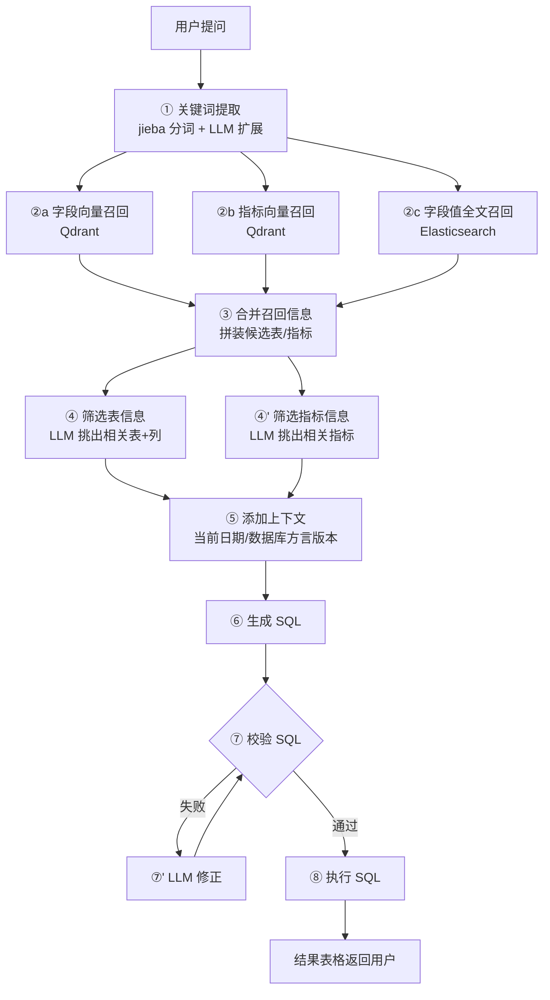

# 掌柜问数 · 产品文档

> 版本:v1.0 ｜ 更新日期:2026-10-05 ｜ 文档读者:产品 / 业务 / 所有项目成员

---

## 1. 产品定位

**一句话定位**:面向"掌柜"(门店老板 / 业务运营)的**对话式数据问答助手**——不会写 SQL 也能随时问数,把"提需求 → 排期 → 出报表"的天级/周级链路,压缩到**秒级对话**。

**解决的问题**:

| 传统取数模式 | 痛点 | 掌柜问数方案 |
|--------------|------|--------------|
| 业务提需求 → 数据同学写 SQL | 需求排队,交付周期以天计 | 自然语言直接问,秒级返回 |
| 固定报表看板 | 维护成本高,灵活性差 | 任意维度组合即席查询 |
| 问数口径靠人口口相传 | 口径混乱,数字对不上 | 指标语义层统一口径(指标知识库) |

## 2. 目标用户与典型场景

| 用户 | 典型问题 | 价值 |
|------|----------|------|
| 门店老板(掌柜) | "上个月哪个品类卖得最好?" | 不依赖人,随时掌握经营状况 |
| 运营人员 | "统计一下2025年1月份各品类的销售额占比" | 即席分析,免写 SQL |
| 数据同学 | 复杂取数的初步 SQL 由系统生成,人工审核微调 | 释放重复劳动,聚焦高价值工作 |

## 3. 功能清单

| 编号 | 功能 | 说明 | 状态 |
|------|------|------|------|
| F1 | 自然语言问数 | 中文提问 → 自动生成并执行 SQL → 返回结果 | ✅ 已上线 |
| F2 | 过程流式展示 | SSE 实时推送"抽取关键词/召回/筛选/生成SQL/执行"各阶段,过程可感知 | ✅ 已上线 |
| F3 | 结构化结果表格 | 查询结果自动渲染为表格,自动识别列名(含中文别名) | ✅ 已上线 |
| F4 | 指标语义层 | 指标(GMV/AOV…)统一口径,别名命中(如"销售额/成交总额/收入") | ✅ 已上线 |
| F5 | 元数据驱动扩展 | 新增表/字段/指标只需编辑 `meta_config.yaml` 并重建知识库,不改代码 | ✅ 已上线 |
| F6 | SQL 自动纠错 | 校验失败自动回流 LLM 修正后重试 | ✅ 已上线 |
| F7 | 多轮对话追问 | "那再按省份拆一下"等上下文追问 | 🗓 规划中 |
| F8 | 图表可视化 | 结果自动推荐柱状/饼图 | 🗓 规划中 |
| F9 | 权限与行级管控 | 按用户/门店隔离数据 | 🗓 规划中 |

## 4. 端到端流程

**设计要点**:
- **召回-筛选两段式**:先"宽召回"(向量+全文,宁多勿漏)再"精筛选"(LLM 裁剪,宁准勿杂),兼顾召回率与上下文长度。
- **字段值召回是特色**:用户说"Q1",ES 全文检索能把 `dim_date.quarter.Q1` 这类**字段值**找回来,这是纯向量召回的盲区。
- **上下文注入当前日期**:让"上个月""近7天"这类相对时间可被 LLM 正确换算。

## 5. 示例问答实录

**输入**:`统计一下2025年1月份各品类的销售额占比`

| 阶段 | 系统行为(真实日志) |
|------|---------------------|
| 抽取关键词 | `['销售额', '品类', '统计', '月份']` |
| 召回 | 字段 8 条(date_id/order_amount/category/month…)、指标 2 条(GMV/AOV)、字段值 1 条(dim_date.quarter.Q1) |
| 筛选 | 表:`fact_order, dim_date, dim_product`;指标:`GMV` |
| 生成 SQL | JOIN 三表 + GROUP BY 品类 + 窗口函数算占比(见 README) |
| 执行 | 6 行结果,手机数码占 72.26% |

## 6. 产品边界与限制

| 边界 | 说明 |
|------|------|
| 单轮问答 | 当前不支持多轮追问(规划 F7) |
| 目标数据库 | MySQL 8(方言硬编码,跨库需扩展 add_context 的 db_info) |
| 数据规模 | 面向课程/演示数据量;生产级需考虑 SQL 超时与结果行数上限 |
| 语义依赖 | 回答质量依赖元数据描述与别名维护质量(产品化后需提供知识库运营工具) |
| 输出确定性 | LLM 生成 SQL 存在不确定性,已用"校验+修正"兜底;生产环境建议加只读账号、行数上限、SQL 白名单 |

## 7. 迭代规划

| 阶段 | 内容 | 目标 |
|------|------|------|
| P0(当前) | 单轮问数全链路 + 知识库构建 | 跑通闭环 |
| P1 | 多轮对话、图表渲染、查询缓存、结果行数/超时熔断 | 体验与稳定性 |
| P2 | 权限与行级数据管控、知识库运营后台(表/指标在线维护)、同环比等复合指标 | 生产化 |
