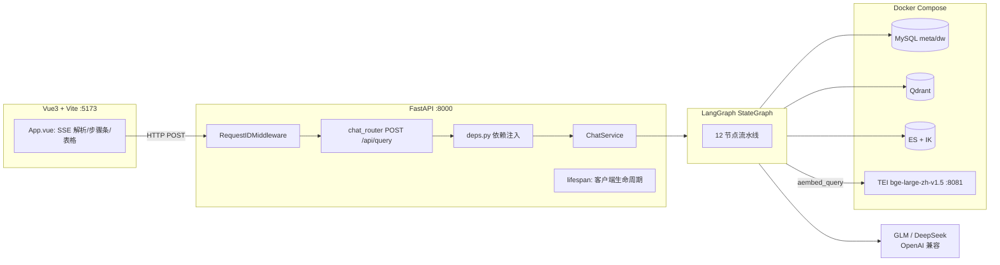
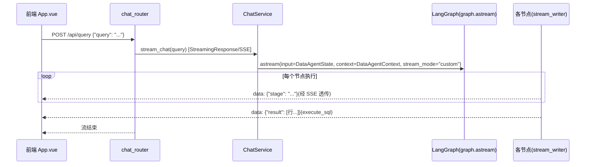

# 掌柜问数 · 开发文档

| 文档信息 | 内容 |
|----------|------|
| **编写** | DeepSeek AI 工程组 · 资深 AI 开发工程师 |
| 版本 / 日期 | v2.0 / 2026-10-05 |
| 读者 | 后端 / 前端 / 数据开发者 |
| 关联文档 | [产品文档](产品文档.md) ｜ [学习指南](学习指南.md) |

> 本文所有描述均锚定仓库实际代码(文件:行号级),并包含一节**已知问题与改进清单**(§12)——以资深评审视角如实记录当前实现的技术债。

---

## 1. 系统概览



**一次请求的完整时序**:



**启动时序(lifespan)**:`app/core/lifespan.py` 按序 `init()` 五个客户端:dw_mysql → meta_mysql → es → qdrant → embedding;关闭时逐个 `await close()`(注意:embedding 客户端未实现 close,见 §12-K9)。

---

## 2. 模块地图

```
data-agent/
├── main.py                          # 10 行:FastAPI(lifespan) + chat_router + RequestIDMiddleware
├── conf/app_config.yaml             # 运行配置(账密空串,由 .env 注入)
├── conf/meta_config.yaml            # 知识库定义:5 表 30 字段 + 2 指标
├── prompts/*.prompt                 # 8 个提示词(7 个在用,plan_sql 预留未接线,见 §8.5)
├── docker/                          # 编排 + .env + ES/IK 自建镜像 + bge 模型目录
└── app/
    ├── core/       logging.py(loguru+request_id) context.py(ContextVar) middleware.py lifespan.py
    ├── config/     app_config.py(dataclass+env注入) meta_config.py config_loader.py(OmegaConf)
    ├── clients/    mysql_client.py qdrant_client.py es_client.py embedding_client.py
    ├── models/     mysql/ 4 张 ORM 表   qdrant/ 2 个 TypedDict   es/ 1 个 TypedDict
    ├── repositories/  mysql/(meta,dw)  qdrant/(base,column,metric)  es/(value)
    ├── prompt/     prompt_loader.py(按名读 prompts/{name}.prompt)
    ├── schemas/    chat.py(QuerySchema)
    ├── api/        routers/chat_router.py  deps.py(DI 树)
    ├── service/    chat_service.py  meta_knowledge_service.py(知识库构建)
    ├── scripts/    build_meta_knowledge.py(CLI 入口)
    └── agent/      graph.py state.py context.py llm.py + nodes/(12 节点)
```

## 3. 配置体系

| 文件 | 提交 | 内容与要点 |
|------|------|------------|
| `conf/app_config.yaml` | ✅ | logging / db_meta / db_dw / qdrant(embedding_size=1024) / embedding(:8081) / es(index_name=data_agent) / llm(model_name, base_url);**password 与 api_key 为空串** |
| `data-agent/.env` | ❌ | `APP_DB_PASSWORD`、`APP_LLM_API_KEY` |
| `docker/.env` | ❌ | `MYSQL_ROOT_PASSWORD`(仅数据卷**首次初始化**生效) |
| `conf/meta_config.yaml` | ✅ | 见 §6 知识库定义 |

**注入机制**(`app/config/app_config.py`):
1. `load_config(AppConfig, yaml)`:OmegaConf `structured(schema) → load → merge → to_object`,schema 校验与默认值二合一;
2. `_load_dotenv(项目根/.env)`:极简解析(KEY=VALUE/#注释/去引号),`os.environ.setdefault`(已设置的环境变量优先于 .env,便于 CI 覆盖);
3. `_apply_env_overrides()`:回填 `db_meta/db_dw.password` 与 `llm.api_key`,缺失时打印告警(不抛异常,让下游连接错误带出上下文)。

**新增敏感配置的三处一致原则**:yaml 留空 → `.env.example` 加模板 → `_apply_env_overrides` 加覆盖。

**LLM 接入**(`app/agent/llm.py`):

```python
llm = init_chat_model(model=model_name, api_key=api_key, temperature=0,
                      model_provider="openai", base_url=app_config.llm.base_url)
```

- `model_provider="openai"` 必须显式:`init_chat_model` 按模型名前缀推断 provider,`glm/deepseek` 不在其映射表,缺失即抛 `Unable to infer model provider`;
- 全局 `temperature=0`:NL2SQL 场景要确定性;
- 全局单例:模块导入即构建,所有节点共享。

## 4. 客户端层

| 客户端 | 关键实现 | 参数 |
|--------|----------|------|
| `mysql_client.py` | `create_async_engine(mysql+asyncmy://...)` × 2 实例(dw/meta,模块级单例) | `pool_size=10, max_overflow=20, pool_pre_ping=True`;`async_sessionmaker(autoflush=False, expire_on_commit=False)` |
| `qdrant_client.py` | `AsyncQdrantClient(host, port)`,HTTP :6333 | — |
| `es_client.py` | `AsyncElasticsearch(hosts=[url])` | — |
| `embedding_client.py` | `HuggingFaceEndpointEmbeddings(model=f"http://{host}:{port}")` 指向 TEI | TEI 容器侧 `MAX_CONCURRENT_REQUESTS=16, MAX_BATCH_TOKENS=16384` |
| `agent/llm.py` | 见 §3 | temperature=0 |

> 注意:URL 拼接用户名/密码(`_get_url`)要求密码不含 `@:` 等保留字符;若未来密码含特殊字符需改用 `URL.create()` 转义构造。

## 5. 数据模型

### 5.1 meta 库(SQLAlchemy ORM,`app/models/mysql/`)

| 表 | 主键 | 字段 | 说明 |
|----|------|------|------|
| `table_info` | id=表名 String(64) | name, role(fact/dim), description(Text) | 表级知识 |
| `column_info` | id=`表名.列名` | name, type, role(primary_key/foreign_key/dimension/measure), **examples(JSON)**, description, **alias(JSON)**, table_id | 字段级知识;examples 来自 dw 真实采样 |
| `metric_info` | id=指标名 | name, description, relevant_columns(JSON), alias(JSON) | 指标口径 |
| `column_metric` | — | column_id + metric_id | 指标↔字段 junction |

### 5.2 dw 库(`docker/mysql/dw.sql` 初始化)

`dim_region`(region_id PK) / `dim_customer` / `dim_product` / `dim_date`(date_id PK, year/quarter/month/day) / `fact_order`(order_id PK,customer_id/product_id/date_id/region_id FK,order_quantity/order_amount measures),utf8mb4。

### 5.3 Qdrant(`app/repositories/qdrant/base_repository_qdrant.py`)

- 集合:`data_agent_column`、`data_agent_metric`(`ensure_collection()` 不存在才创建)
- 向量:`VectorParams(size=app_config.qdrant.embedding_size /*1024*/, distance=Distance.COSINE)`
- `search(vector, score_threshold=0.6, limit)`:调 `query_points`,按余弦阈值过滤,返回 payload 列表
- `upsert(ids, embeddings, payloads, batch_size=10)`:批量 PointStruct 写入

Payload 结构 = `ColumnInfoQdrant / MetricInfoQdrant`(TypedDict,字段同 meta 库对应表)。

### 5.4 Elasticsearch(`value_es_repository.py`)

索引 `data_agent`,mapping:

```python
"value":  {"type": "text", "analyzer": "ik_max_word", "search_analyzer": "ik_max_word"},
"id/type/column_id/column_name/table_id/table_name": {"type": "keyword"}
```

`query()`:match 查询 + `min_score=0.6` + `size=5`。**注意语义差异**:ES 的 `_score` 是 BM25 分值(无统一上限),与 Qdrant 的余弦相似度(0~1)不是一回事,同样的 0.6 在两边松紧完全不同(见 §12-K7)。

## 6. 知识库构建流水线(`meta_knowledge_service.py`,CLI:`app/scripts/build_meta_knowledge.py`)

```
build_meta_knowledge(meta_config)
 ├─ ① _save_tables_to_meta_db      逐表:TableInfoMySQL(id=表名);
 │    逐字段:show columns from {table} 取真实类型(dw_repo.get_column_types)
 │           + get_column_values(group by 采样 10 条)作 examples
 │    → meta 库事务写入(session.begin() + add_all)
 ├─ ② _sync_columns_to_qdrant      **一个字段拆多条向量**:name / description / 每个 alias
 │    各自独立 embed(每条 payload 都是完整字段信息);embed 批 20,upsert 批 10
 ├─ ③ _sync_values_to_es           仅 sync:true 字段;每字段 group by 全量取值(上限 100000)
 │    文档 id = "表.列.值";ES bulk 批 10
 ├─ ④ _save_metrics_to_meta_db     metric_info + column_metric 关联
 └─ ⑤ _sync_metrics_to_qdrant      同②的三重文本(name/description/别名)
```

**设计解读**:
- **三重嵌入**(name/description/alias 各一条向量)是召回率的关键:用户说"销售额"命中 alias 向量,说"订单金额情况"命中 description 向量——等价于给同一字段建了多路索引;
- `sync` 开关的取舍:维度值少的字段(如 quarter)适合灌 ES;度量/主键(false)灌进去只会制造噪音和体积;
- **幂等性缺陷**:全程 upsert 不清理,`meta_config.yaml` 里删掉的字段/别名,其旧向量与旧 ES 文档会残留(见 §12-K8),重建前需手动清 collection/index。

## 7. Agent 状态机(核心)

### 7.1 State(`app/agent/state.py`,TypedDict)

| 字段 | 类型 | 生产者 | 消费者 |
|------|------|--------|--------|
| query | str | 入口 | 全部 |
| keywords | list[str] | extract_keywords(jieba 词性过滤 + 原句 + 数值过滤 + set 去重) | 三路召回 |
| retrieved_columns / retrieved_metrics | list[Qdrant payload] | column_recall / metric_recall | merge |
| retrieved_values | list[ValueInfoES] | value_recall | merge |
| table_infos | list[TableInfoState] | merge(组装)→ filter_table_info(裁剪) | generate_sql / correct_sql |
| metric_infos | list[MetricInfoState] | merge → filter_metric_info | generate_sql / correct_sql |
| date_info / db_info | DateInfoState / DBInfoState | add_context | generate_sql / correct_sql |
| sql | str | generate_sql →(correct_sql 覆写) | validate_sql / execute_sql |
| error | str\|None | validate_sql | 条件边 |

> LangGraph 对 TypedDict 状态的默认合并策略是**整体替换**:节点 return 的 key 直接覆盖旧值——所以 filter 节点返回裁剪后的完整列表即可。

### 7.2 Context(`app/agent/context.py`)

六个依赖注入对象:两个 Qdrant repo、ValueES repo、embedding_client、meta/dw 两个 MySQL repo。节点通过 `runtime.context['xxx']` 取用——**业务数据与资源依赖分离**是本工程最重要的结构决策:节点保持纯函数式,测试时可注入 mock。

### 7.3 图拓扑(graph.py 逐行对应)

```python
START → extract_keywords
extract_keywords → {column_recall, value_recall, metric_recall}        # 三路并行
{column_recall, value_recall, metric_recall} → merge_retrieved_info    # 汇聚(join)
merge_retrieved_info → {filter_table_info, filter_metric_info}         # 并行
{filter_table_info, filter_metric_info} → add_context
add_context → generate_sql → validate_sql
validate_sql -(条件边, lambda state: "execute_sql" if state["error"] is None else "correct_sql")
execute_sql → END
```

### 7.4 节点逐个剖析

| # | 节点 | 核心逻辑(代码级) | 关键参数 |
|---|------|--------------------|----------|
| 1 | extract_keywords | `jieba.analyse.extract_tags(query, allowPOS=12 种词性)` + 追加原句 + `is_numeric` 过滤 + `set` 去重 | allowPOS=(n,nr,ns,nt,nz,v,vn,a,an,eng,i,l) |
| 2 | column_recall | LLM 扩词(`extend_keywords_for_column_recall`→JsonOutputParser 出 JSON 数组)∪ jieba 词;**逐关键词** `aembed_query` → `search(embedding, 0.6, 5)`;按 `column.id` 跨词去重(columns_map) | 阈值 0.6 / topK 5 |
| 3 | value_recall | 同上,但走 ES `query(keyword, min_score=0.6, limit=5)`,按 `value.id` 去重 | ⚠️ 见 §12-K7 |
| 4 | metric_recall | 同 column_recall,Qdrant 指标集合 | ⚠️ 第 31 行用了**同步** `chain.invoke`,阻塞事件循环(§12-K2) |
| 5 | merge_retrieved_info | ① 值召回回填:retrieved_values 的 value 追加到对应 column 的 examples(不在则整列从 meta 库捞回);② 指标 relevant_columns 对应列也捞回;③ 按 table_id 分组组表;④ **`get_key_columns_by_table_id` 自动补齐主外键列**(召回没带到也能 JOIN) | — |
| 6 | filter_table_info | `prompts/filter_table_info` → JsonOutputParser → `{"表名": ["字段", ...]}`;遍历副本 `table_infos[:]` 删表/删列 | — |
| 7 | filter_metric_info | `prompts/filter_metric_info` → JSON 数组(允许空),裁剪 metric_infos | — |
| 8 | add_context | 本地 `datetime.today()` → date/weekday/quarter(`Q{(month-1)//3+1}`);`get_db_info()` 取 dialect+version | ⚠️ 用应用时钟而非 DB 时钟(§12-K5) |
| 9 | generate_sql | `prompts/generate_sql` 注入 table_infos/metric_infos/date_info/db_info/query → **StrOutputParser**(纯文本单条 SQL,禁 Markdown 围栏) | temperature=0 |
| 10 | validate_sql | `EXPLAIN {sql}`:能 explain 即视为合法(语法/表列存在性);失败 `error=str(e)` | — |
| 11 | correct_sql | `prompts/correct_sql` 携带 query/sql/error/全部上下文,输出修复后 SQL,覆写 `state["sql"]` | — |
| 12 | execute_sql | `execute(sql)` → `[dict(row) for row in mappings().fetchall()]` → `writer({"result": ...})` | ⚠️ 无行数上限(§12-K4) |

### 7.5 提示词设计解析(prompts/)

| 提示词 | 角色 | 输出契约 | 设计要点 |
|--------|------|----------|----------|
| generate_sql | 资深 DBA+数据分析师 | 单条 SQL 纯文本(StrOutputParser) | 六条铁律:只用真实表字段/指标口径强制/只读/合方言/仅一条/禁 Markdown 围栏 |
| filter_table_info | 查询规划专家 | JSON `{"表":["字段"]}`(JsonOutputParser) | "最小必要集合";每张入选表至少一个入选字段;时间/状态/行为/指标四类语义覆盖规则;消歧字段必须保留 |
| filter_metric_info | 指标筛选专家 | JSON 数组,**允许空** | 最小集合;"仅用于筛选分组的字段不算指标";附正反两例 few-shot |
| extend_keywords_for_column_recall | 字段推断专家 | JSON 数组(中文字段概念) | 产出"必需字段概念"而非实体值——为向量检索造查询词 |
| extend_keywords_for_value_recall / _metric_recall | 同族 | JSON 数组 | 分别面向取值/指标语义 |
| correct_sql | SQL 调试专家 | 单条 SQL 纯文本 | 九条纪律:基于错误最小修复/语义不变/不改结构/禁写操作 |
| **plan_sql(未接线)** | 查询规划 | 三步规划文本 | ⚠️ 无节点加载;文件内有重复段落与编号跳号(1-7,9),属**两阶段"先规划后生成"设计的预留稿**(§12-K10) |

**JsonOutputParser vs StrOutputParser 的选择逻辑**:结构化判定(筛表/筛指标/扩词)用 JSON + JsonOutputParser 自稳解析;SQL 必须裸文本(否则 EXPLAIN 会吃到 Markdown 围栏)用 StrOutputParser + 提示词双重禁围栏。

## 8. API 层与横切面

### 8.1 接口契约(`chat_router.py` + `schemas/chat.py`)

```
POST /api/query        body: {"query": string}(Pydantic QuerySchema 校验)
响应: StreamingResponse(media_type="text/event-stream")
  data: {"stage": "抽取关键词"}          ← 各节点 stream_writer({"stage":...})
  data: {"result": [{列: 值, ...}]}      ← execute_sql 推送(仅此一次)
  data: {"error": "..."}                 ← 异常透传(chat_router event_stream 兜底 except)
```

### 8.2 依赖注入(`api/deps.py`)

请求级 DI 树:`get_chat_service` ← graph / meta_repo / dw_repo / 两个 qdrant repo / es repo / embedding_client;其中 `get_dw_session / get_meta_session` 用 `async with session_factory()` 保证**每请求独立会话、用完即还池**。

### 8.3 横切面

- **RequestID**(`core/middleware.py` + `core/context.py`):取 `X-Request-ID` 或生成 uuid → `contextvars.ContextVar` → loguru 打日志自动带出(`request_id - <id>`),响应头回写——全链路日志串联的基础。graph.py 的 `main()` 手工 `set("1")` 即为脱离 HTTP 跑图时的占位。
- **日志**(`core/logging.py`):loguru,文件(10MB 轮转/7 天保留)+ 控制台双通道,INFO 级。

## 9. 前端实现(`date-agent-frontend/src/App.vue`)

- **SSE 手工解析**(未用 EventSource,因需 POST+JSON body):`fetch` → `response.body.getReader()` → `TextDecoder(stream:true)` → 按 `\n\n` 切事件、剩余进 buffer → `data:` 行 JSON.parse。**流式解码 `{stream:true}` 是中文不乱码的关键**。
- **消息模型**:`messages[]` 中 assistant 消息三种 type——`steps`(步骤条,状态机 running→success/error)、`table`(columns 取 `Object.keys(result[0])`,行数据直接渲染)、`error`。
- **代理**:`vite.config.js` 把 `/api` 转发 `http://localhost:8000` 并强制 `Connection: keep-alive`。

## 10. 一次真实请求的全链路耗时剖析(2026-10-03 日志)

| 阶段 | 耗时 | 瓶颈分析 |
|------|------|----------|
| extract_keywords | <1s | jieba 本地,无 LLM |
| 三路召回 | **~41s / ~38s** | 每路 = 1 次 LLM 扩词(5~10s)+ **逐关键词串行 aembed_query**(CPU TEI 单次 1~3s × N)+ 逐词检索 |
| 筛选表/指标 | ~19s | 2 次 LLM 调用(并行) |
| 生成 SQL | ~9s | 1 次 LLM 调用 |
| 校验+执行 | ~0.1s | EXPLAIN + SELECT |
| **合计** | **~108s** | 召回占 73% |

**优化路线(按 ROI 排序)**:
1. 召回节点内 `asyncio.gather` 并发嵌入 + 改用 `aembed_documents` 批量(预期 →30s 内);
2. TEI 换 GPU 或 ONNX 量化(单次 1~3s → 数十 ms);
3. 关键词嵌入结果 LRU 缓存(重复词跨请求命中);
4. 三路召回的 LLM 扩词合并为一次调用(省 2 次 RTT,需权衡提示词复杂度)。

## 11. 安全规范

1. 账密/Key 只存 `.env`(gitignore);新增敏感项遵守"三处一致"(§3);
2. 提交前扫描:`git diff --cached | grep -in "password\|api_key"` 不应有真实值;
3. Key 泄露(误提交/外发)→ 立即在平台后台轮换,只改 `.env`;
4. **生产化必做**:execute_sql 使用只读账号、结果行数上限、语句超时(当前 root + 无上限,见 §12-K3/K4)、SQL 审计日志。

## 12. 已知问题与改进清单(评审记录)

> 以下为对当前代码的如实评审结论,按优先级排序。P0=影响功能正确性,P1=生产化阻塞,P2=工程质量。

| ID | 级别 | 问题 | 代码位置 | 影响 | 修复建议 |
|----|------|------|----------|------|----------|
| K1 | **P0** | **correct_sql 节点无出边**:图定义中没有任何 `add_edge("correct_sql", ...)`,LangGraph 视其为终点——修正后的 SQL **不会回流 validate_sql,也不会执行**,用户只看到步骤条戛然而止 | `graph.py:44,60-62` | F6 自动纠错实际不可用 | `graph_builder.add_edge("correct_sql", "validate_sql")`;并加修正次数计数器防死循环 |
| K2 | P1 | metric_recall 用同步 `chain.invoke`(其余节点均 `await ainvoke`),LLM 调用期间**阻塞整个事件循环**,拖慢并行的另两路召回 | `metric_recall.py:31` | 时延、并发 | 改 `await chain.ainvoke(...)` |
| K3 | P1 | LLM 生成的 SQL 以 **root 全权账号**执行;EXPLAIN 校验不拦写语句 | `dw_mysql_repository.py:57` | 数据安全 | 独立只读账号;执行前语句白名单校验(仅 SELECT) |
| K4 | P1 | execute_sql 无行数上限/超时,大结果集直接全量 fetchall | `dw_mysql_repository.py:57-59` | 拖垮数仓/前端 | `LIMIT` 包裹 + `max_overflow` 语句超时 + 分页 |
| K5 | P2 | add_context 用**应用服务器本地时钟**;dw 库另有 `get_date_info` 但其 `strftime("%Q")` 在 Python 中是非法指令(疑似因此弃用)——相对时间换算依赖部署机时钟正确 | `add_context.py:13`,`dw_mysql_repository.py:44-52` | 时钟错→相对时间问题全错 | 以 `select now()` 为准,quarter 手工计算(同 add_context 写法) |
| K6 | P2 | keywords 用 `set()` 去重,顺序不稳定 → 同一问题两次运行的召回顺序可能不同,复现性差 | `extract_keywords.py:42` 等三处 | 可复现性 | `dict.fromkeys()` 保序去重 |
| K7 | P2 | ES `min_score=0.6` 与 Qdrant 余弦阈值 0.6 **语义不等价**(BM25 分值无统一量纲),同名阈值行为不一致 | `value_recall.py:34`,`value_es_repository.py:48` | 召回调参困难 | ES 侧改用相关性调参或归一化,文档标注差异 |
| K8 | P2 | 知识库重建只 upsert 不清理,已删除字段/别名的旧向量与 ES 文档残留 | `meta_knowledge_service.py:96-124` | 召回脏数据 | 重建前 delete_collection/recreate index,或按 table_id 前缀定点清理 |
| K9 | P2 | lifespan 未关闭 embedding 客户端(也未实现 close),aiohttp 会话随进程退出 | `lifespan.py:20-24` | 资源清理不彻底 | 补 `close()` 并在 lifespan 调用 |
| K10 | P2 | `prompts/plan_sql.prompt` 无节点引用("先规划后生成"两阶段设计的预留稿);文件内"全局约束"段落重复、编号跳号(1-7,9) | `prompts/plan_sql.prompt` | 死代码 | 接入 generate_sql 前置节点或移除;清理文稿 |
| K11 | P2 | dw_repository 两处 f-string 拼 SQL 标识符(`show columns from {table}` 等) | `dw_mysql_repository.py:17,22` | 输入源受控(meta_config)但属注入模式 | 标识符白名单校验/反引号包裹 |
| K12 | P2 | merge/filter 节点 return `dict_values` 而非 list(state 注解为 list);extract 关键词 set 无序 | `merge_retrieved_info.py:44,39` | 运行时可用,类型注解失真 | 统一 `list(...)` |

## 13. 故障排查手册

| 症状 | 根因 | 处置 |
|------|------|------|
| docker pull 超时/EOF | 直连 Docker Hub 不稳 | Engine 配 `registry-mirrors`;**build 阶段加速器不生效**,需改 Dockerfile FROM 前缀(如 `docker.m.daocloud.io/library/...`)或 buildx 配 buildkitd.toml |
| 容器名 `/mysql` 冲突 | 存在同名旧容器 | `docker rm -f mysql` 或 rename |
| initdb SQL 不执行 | entrypoint **仅数据卷为空的首次启动**执行 | `docker cp` 进容器手动导入;或 down + `volume rm` 重置(数据即弃) |
| MySQL 1044 | 认证过但无库权限 | `GRANT ALL ON db.* TO 'user'@'%'` |
| MySQL 1045 | 密码错,**或宿主端口被本机 MySQL 抢占**(绑定失败但 ps 仍显示映射) | 容器内 socket 验证;`netstat -ano`+`tasklist` 查端口归属 |
| MySQL 1146 | 库在表不在 | 同"initdb 不执行" |
| YAML `expected '<document start>'` | 顶层键被缩进(1 格都不行) | 顶层顶格,层级用空格 |
| `'uv' 不是内部或外部命令` | uv 未装 | `pip install uv -i https://pypi.tuna.tsinghua.edu.cn/simple` |
| 装了依赖仍 ModuleNotFoundError | 跑在全局 Python | 一律 `uv run`;`sys.executable` 验证 |
| `Unable to infer model provider for model='glm-5.3'` | provider 靠模型名推断失败 | 显式 `model_provider="openai"` + `base_url` |
| PyCharm 调试器 `UnicodeDecodeError`(pydevd_comm) | pydevd 分块读输出,中文多字节跨块截断(2024.3 缺陷) | 升级 IDE / pydevd 增量解码补丁 / Run+pdb |
| Debug main.py 秒退 | main.py 只定义 app 不起服务 | Module 模式跑 `uvicorn main:app` |
| embedding `Connection was reset` | 8081 被占或系统代理劫持 | netstat 查归属;`NO_PROXY=localhost,127.0.0.1` |
| `model must be a HuggingFace repo ID, not a URL` | 新版 langchain-huggingface 拒绝 URL | 锁旧版,或改 `OpenAIEmbeddings(base_url=.../v1, check_embedding_ctx_length=False)` |
| 步骤条停在"校正SQL"后无结果 | **K1:correct_sql 无出边**(§12) | 见 K1 修复 |
