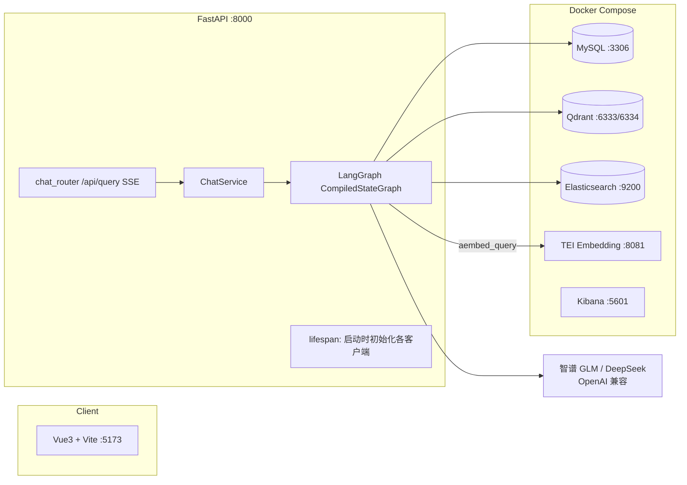

# 掌柜问数 · 开发文档

> 版本:v1.0 ｜ 更新日期:2026-10-05 ｜ 文档读者:后端/前端/数据开发者

---

## 1. 架构与技术选型



| 组件 | 选型 | 选型理由 |
|------|------|----------|
| Agent 编排 | LangGraph | 有状态图、节点并行(三路召回)、条件边(SQL 校验回流)、自定义流式输出 |
| LLM | GLM / DeepSeek | OpenAI 兼容协议,`init_chat_model(model_provider="openai", base_url=...)` 接入 |
| Embedding | TEI + bge-large-zh-v1.5 | CPU 可跑、中文效果好、1024 维;容器化一键部署 |
| 向量库 | Qdrant | 字段/指标语义召回 |
| 全文检索 | Elasticsearch + IK | **字段值**召回(向量召回对"Q1"这类短枚举值是盲区) |
| 元数据库 | MySQL | meta 库存知识库,db 库存业务数据 |

## 2. 目录结构(data-agent)

```
data-agent/
├── main.py                     # FastAPI 入口:创建 app、挂路由与中间件
├── conf/
│   ├── app_config.yaml         # 运行配置(账密为空,从 .env 注入)
│   └── meta_config.yaml        # 元数据知识库定义:表/字段/指标/别名/是否同步
├── prompts/                    # 8 个提示词模板(节点运行时加载)
├── docker/                     # 中间件编排(见 §5)
└── app/
    ├── core/                   # lifespan(客户端生命周期)、日志(loguru)、RequestID 中间件
    ├── config/                 # 配置加载与 .env 注入
    ├── clients/                # mysql_client(异步引擎)、qdrant_client、es_client、embedding_client
    ├── models/                 # ORM 模型(meta 库三表) + Qdrant/ES 文档模型
    ├── repositories/           # 数据访问层(MySQL/Qdrant/ES)
    ├── service/                # ChatService(问答)、MetaKnowledgeService(知识库构建)
    ├── scripts/                # build_meta_knowledge.py 知识库构建入口
    ├── schemas/                # QuerySchema 请求模型
    ├── api/                    # chat_router(SSE)、deps(依赖注入)
    └── agent/                  # ★ 核心:图定义 + 状态 + 上下文 + 12 个节点
        ├── graph.py            # 图编排(节点注册/边/条件边)+ main() 测试入口
        ├── state.py            # DataAgentState(TypedDict,全流程数据载体)
        ├── context.py          # DataAgentContext(依赖注入:各 repository/client)
        ├── llm.py              # init_chat_model(model_provider/base_url 从配置)
        └── nodes/              # extract_keywords / *_recall / merge / filter_* / add_context
                                #  / generate_sql / validate_sql / correct_sql / execute_sql
```

## 3. 配置体系(账密不落盘)

| 文件 | 提交到 git? | 内容 |
|------|-------------|------|
| `conf/app_config.yaml` | ✅ | 日志/数据库/中间件地址、LLM 模型名与 base_url;**password 与 api_key 为空串** |
| `conf/meta_config.yaml` | ✅ | 表/字段/指标语义定义(`sync: true` 的字段与指标会同步进向量库/ES) |
| `data-agent/.env` | ❌ gitignore | `APP_DB_PASSWORD`、`APP_LLM_API_KEY`(真实账密) |
| `data-agent/.env.example` | ✅ | 上者的模板 |
| `docker/.env` | ❌ gitignore | `MYSQL_ROOT_PASSWORD`(仅数据卷首次初始化生效) |
| `docker/.env.example` | ✅ | 上者的模板 |

**注入机制**(`app/config/app_config.py`):配置加载后执行 `_load_dotenv(项目根/.env)` → `_apply_env_overrides()` 用 `APP_DB_PASSWORD` / `APP_LLM_API_KEY` 回填 `app_config`。新增敏感配置项时:yaml 留空 + `.env.example` 加模板 + `_apply_env_overrides` 加覆盖,三处缺一不可。

**LLM 接入要点**:非 OpenAI 模型走 OpenAI 兼容协议时必须显式指定 provider,否则 `init_chat_model` 按模型名前缀推断会失败(glm/deepseek 前缀不在其映射表):

```python
llm = init_chat_model(model=..., api_key=..., temperature=0,
                      model_provider="openai", base_url=app_config.llm.base_url)
```

## 4. 核心流程:LangGraph 状态图

### 4.1 状态与上下文

- **DataAgentState**(贯穿全流程的数据):`query` → `keywords` → `retrieved_columns/metrics/values` → `table_infos/metric_infos` → `date_info/db_info` → `sql/error`
- **DataAgentContext**(依赖注入,不含业务数据):各 repository、embedding_client——节点通过 `runtime.context` 取用

### 4.2 图编排(graph.py)

```python
START → extract_keywords → {column_recall, value_recall, metric_recall}   # 三路并行
      → merge_retrieved_info → {filter_table_info, filter_metric_info}    # 两路并行
      → add_context → generate_sql → validate_sql
      → (error is None ? execute_sql : correct_sql → validate_sql)        # 条件边回流
      → execute_sql → END
```

### 4.3 节点职责表

| 节点 | 文件 | 职责 | 关键实现 |
|------|------|------|----------|
| extract_keywords | nodes/extract_keywords.py | 分词+关键词扩展 | jieba + LLM,写入 `keywords` |
| column_recall | nodes/column_recall.py | 字段向量召回 | keywords 向量化 → Qdrant 字段集合;提示词扩展见 prompts/extend_keywords_for_column_recall |
| value_recall | nodes/value_recall.py | 字段值全文召回 | ES `data_agent` 索引(如 `dim_date.quarter.Q1`) |
| metric_recall | nodes/metric_recall.py | 指标向量召回 | Qdrant 指标集合(GMV/AOV) |
| merge_retrieved_info | nodes/merge_retrieved_info.py | 合并三路结果 | 组装候选 `table_infos`(含列)与 `metric_infos` |
| filter_table_info | nodes/filter_table_info.py | LLM 精筛表和列 | PromptTemplate\|llm\|JsonOutputParser;按结果裁剪 table_infos |
| filter_metric_info | nodes/filter_metric_info.py | LLM 精筛指标 | 同上 |
| add_context | nodes/add_context.py | 注入日期/数据库信息 | 当前日期/季度(相对时间换算依据)、MySQL 方言与版本 |
| generate_sql | nodes/generate_sql.py | NL→SQL | 输入:query+筛选后的表/指标+上下文;提示词 prompts/generate_sql |
| validate_sql | nodes/validate_sql.py | SQL 校验 | 失败时写 `state["error"]` 触发条件边 |
| correct_sql | nodes/correct_sql.py | LLM 修错 | 携带错误信息重生成,回流 validate_sql |
| execute_sql | nodes/execute_sql.py | 执行并流式返回 | dw 库只读执行,结果经 stream_writer 推送 |

### 4.4 提示词文件(prompts/)

`generate_sql`、`correct_sql`、`filter_table_info`、`filter_metric_info`、`plan_sql`、`extend_keywords_for_column_recall / _value_recall / _metric_recall`——由 `app/prompt/prompt_loader.py` 按名加载。**调优问答效果优先改这里,而不是改节点代码。**

## 5. 中间件与数据模型(docker/)

| 服务 | 端口 | 要点 |
|------|------|------|
| mysql:8.0 | 3306 | root 密码来自 `docker/.env`;**初始化 SQL 仅在数据卷为空的首次启动执行**(`./mysql:/docker-entrypoint-initdb.d`) |
| elasticsearch(自建镜像) | 9200 | 基于 8.19.10 安装 IK 分词插件(Dockerfile 构建) |
| kibana:8.19.10 | 5601 | 可选,查看 ES |
| qdrant v1.16 | 6333/6334 | 字段、指标两个集合 |
| TEI cpu-1.8 | 8081 | 挂载 `./embedding/bge-large-zh-v1.5` 模型目录 |

**MySQL 两个库**:
- `meta`(知识库):`table_info` / `column_info` / `metric_info`
- `dw`(业务数仓,演示):`dim_region` / `dim_customer` / `dim_product` / `dim_date` / `fact_order`

## 6. 知识库构建(build_meta_knowledge)

```
读取 conf/meta_config.yaml
  → 对每张表查 dw 库真实列类型(show columns)
  → 表/字段/指标写入 meta 库三张表
  → sync:true 的字段与指标向量化后写入 Qdrant
  → 字段示例值写入 ES(data_agent 索引,IK 分词)
```

元数据(`meta_config.yaml`)变更后**必须重跑**:

```bash
uv run python -m app.scripts.build_meta_knowledge -c ./conf/meta_config.yaml
```

## 7. API 契约

`POST /api/query`(SSE 流式响应)

```
请求: {"query": "统计一下2025年1月份各品类的销售额占比"}
响应: text/event-stream
  data: {"stage": "筛选表信息"}                    ← 过程事件(stream_writer 推送)
  data: {"result": [ {...行...}, ... ]}           ← 最终结果
  data: {"error": "..."}                          ← 异常
```

前端经 Vite 代理(`vite.config.js`:`/api → http://localhost:8000`)访问,生产环境由 Nginx 承担同源代理。

## 8. 本地调试指南

| 场景 | 方式 |
|------|------|
| 日常开发 | `uv run fastapi dev`(热重载) |
| PyCharm 调试后端 | Python 配置切 **Module name = uvicorn**,Parameters `main:app --host 127.0.0.1 --port 8000`(直接跑 main.py 不会起服务) |
| 调试 Agent 全链路 | `graph.py` 的 `__main__` 改为 `asyncio.run(main())`(内置测试 query),Run/Debug 该文件即可命中任意节点断点 |
| 断点建议 | 先断 `filter_table_info`(LLM 输入输出最直观);`F7` 进实现,`Alt+Shift+F7` 只进自己代码,`Alt+F8` 现场求值 |

## 9. 安全规范(红线)

1. **任何账密/Key 不得出现在代码、yaml、前端、文档中**,一律走 `.env`(已被 gitignore)
2. 提交前自查:`grep -rn "password\s*[:=]\s*['\"][^'\"]" --include="*.py" --include="*.yaml"` 应无真实值
3. API Key 一旦泄露(提交过 git / 发给他人),**立即在平台后台轮换**
4. 生产化前置:execute_sql 改用**只读账号**、加行数上限与超时熔断、SQL 日志脱敏

## 10. 故障排查手册(实战沉淀)

| 症状 | 根因 | 处置 |
|------|------|------|
| docker pull 超时/EOF | 直连 Docker Hub 不稳 | Docker Engine 配 `registry-mirrors`;build 阶段另需改 Dockerfile `FROM` 为镜像站前缀(如 `docker.m.daocloud.io/library/...`)或给 buildx 配 buildkitd.toml——**registry-mirrors 对 build 的元数据解析不生效** |
| 容器名 `/mysql` 冲突 | 存在同名旧容器 | `docker rm -f mysql` 或 `docker rename mysql mysql_bak` |
| 初始化 SQL(dw.sql/meta.sql)不执行 | MySQL entrypoint **仅在数据卷为空的首次启动**执行 initdb 脚本 | 手动导入:`docker cp xxx.sql mysql:/tmp/` + `docker exec mysql sh -c "mysql -uroot -p\$\$PW < /tmp/xxx.sql"`;或 `docker compose down && docker volume rm <项目>_mysql_data` 重置 |
| MySQL `1044 Access denied ... to database` | 认证通过但无库权限(库可能未建) | 授权:`GRANT ALL ON dw.* TO 'user'@'%'` |
| MySQL `1045 Access denied (using password: YES)` | 密码错,**或宿主机 3306 被本机 MySQL 服务抢占**(docker 端口绑定失败但 ps 仍显示映射) | 容器内 socket 验证密码;`netstat -ano | findstr :3306` + `tasklist /FI "PID eq <pid>"` 查端口归属 |
| MySQL `1146 Table doesn't exist` | 库在表不在 | 见"初始化 SQL 不执行" |
| YAML `expected '<document start>'` | 顶层键缩进了空格(YAML 顶层 1 格都不容忍) | 顶层键顶格,层级用空格不用 Tab |
| `'uv' 不是内部或外部命令` | uv 未安装 | `pip install uv -i https://pypi.tuna.tsinghua.edu.cn/simple` |
| 装了依赖仍 ModuleNotFoundError | 跑在全局 Python 而非项目 .venv | **统一 `uv run`**;看提示符/`sys.executable` 确认 |
| `Unable to infer model provider for model='glm-5.3'` | init_chat_model 按模型名推断 provider 失败 | 显式 `model_provider="openai"` + `base_url`(见 §3) |
| PyCharm 调试器 `UnicodeDecodeError ... pydevd_comm.py` | pydevd 分块读取输出,中文多字节跨块被截断(2024.3 已知缺陷) | 升级 PyCharm;或对 pydevd_comm.py 打**增量解码补丁**;或改用 Run+pdb |
| embedding 请求 `Connection was reset` | 8081 被其他程序占用,或系统代理劫持 localhost | `netstat` 查 8081 归属;代理环境设置 `NO_PROXY=localhost,127.0.0.1` |
| HuggingFaceEndpointEmbeddings 校验 `model must be a repo ID, not a URL` | 新版 langchain-huggingface 拒绝 URL | 锁定与课程匹配的版本,或改用 `OpenAIEmbeddings(base_url=TEI 地址 + /v1, check_embedding_ctx_length=False)` |
